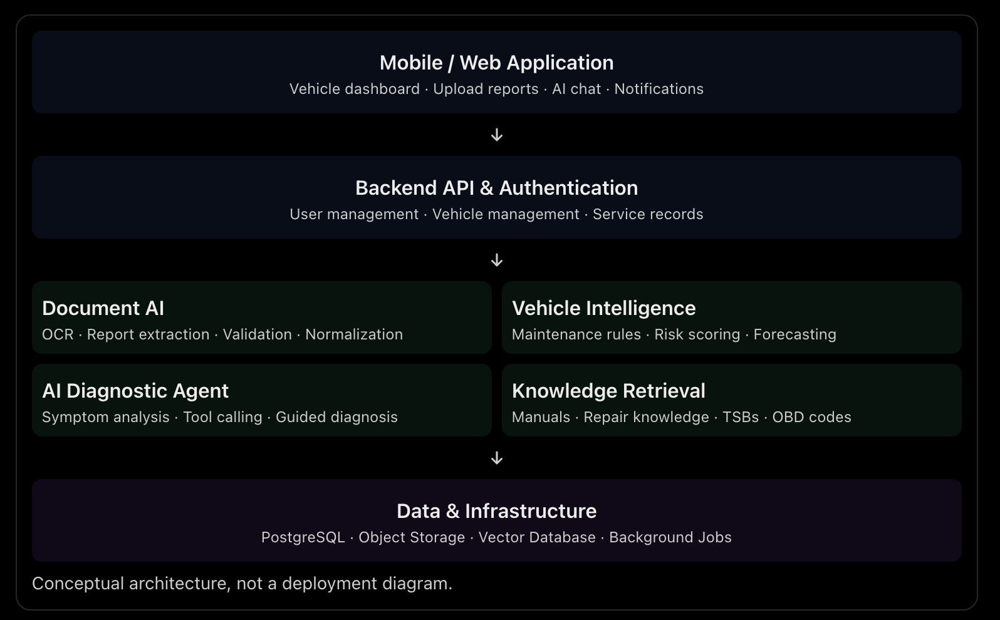
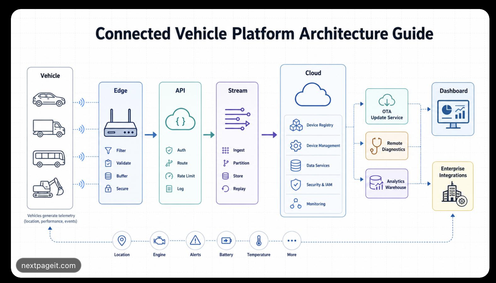
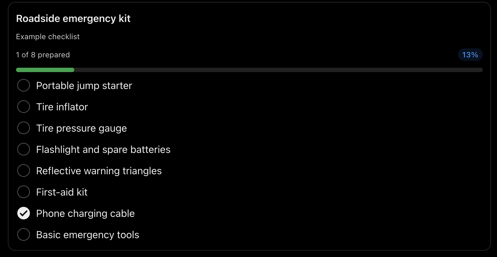
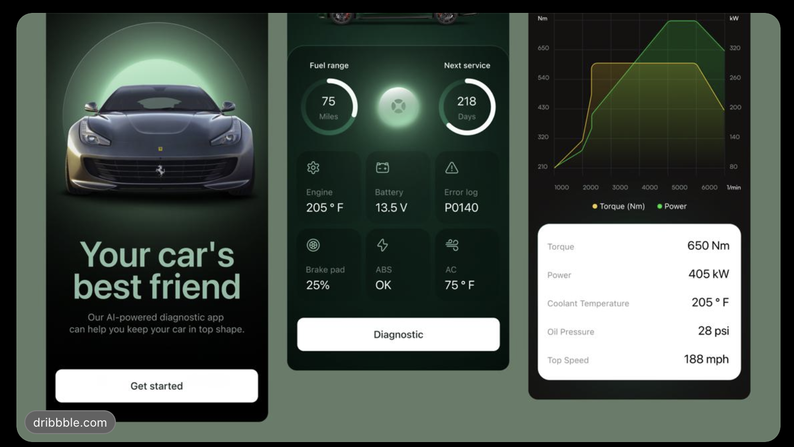
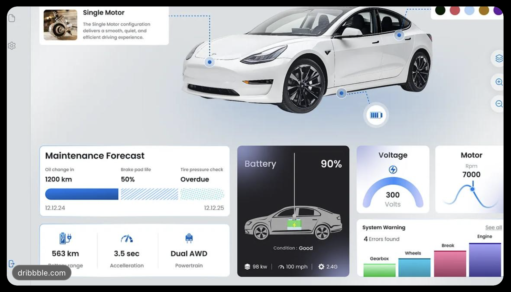
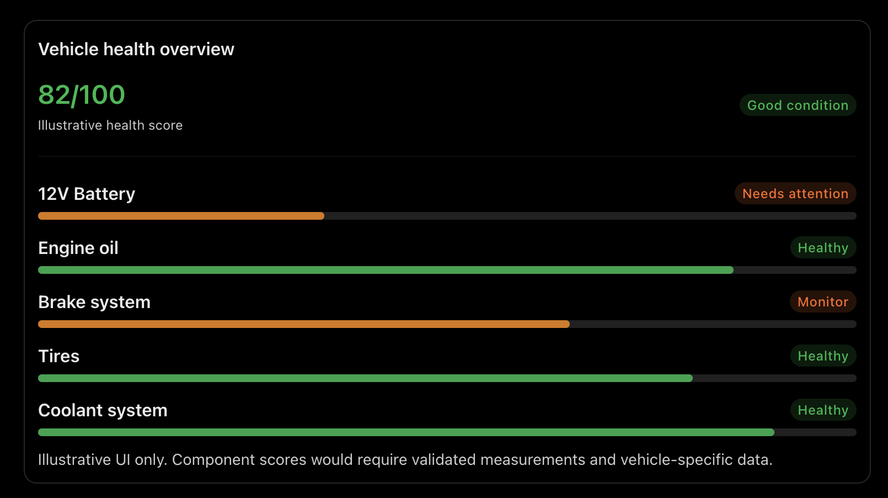
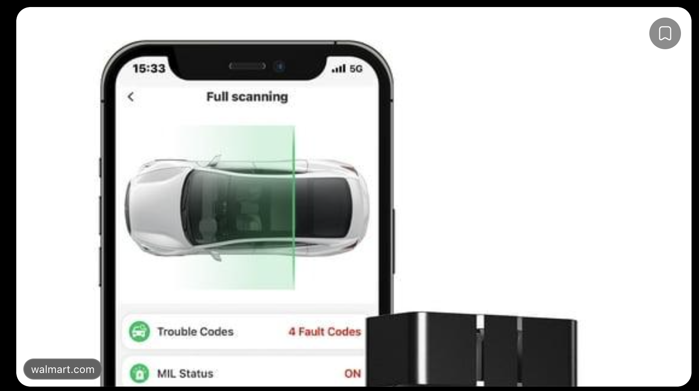

# AutoGuardian — Design

Status: draft · Last updated: 2026-11-18 · Stack: TypeScript frontend, Python backend

## 1. What it is

A personal vehicle health assistant. You upload the documents a dealer or shop gives you; the app
turns them into a structured, permanent history of the car, warns you before likely problems, and
walks you through diagnosing issues when something goes wrong — including offline.

**First target vehicle:** 2018 Honda Accord (trim and engine to be confirmed).
**Long-term:** any car, any user. Car-specific knowledge lives in data, never in code.

### Principles

1. **Evidence over guesses.** Every number shown has a source, a date, and a verified flag.
   No made-up composite "health scores".
2. **Deterministic core, LLM at the edges.** Schedules, mileage math, thresholds and alerts are
   plain code + data. The LLM extracts documents, explains results, and runs diagnostic conversations.
3. **Append-only history.** Measurements are never overwritten; trends come from history.
4. **Prediction ≠ diagnosis.** A part reaching typical lifespan means "inspect", not "failing".
5. **Conservative on safety.** Brakes, steering, overheating, oil pressure, flashing check-engine →
   stop safely and get professional help first.
6. **Works when you need it most.** Emergency guides function with no network.

### Non-goals (for now)

- Live telemetry dashboards (RPM, torque curves, etc.).
- Exact failure-date prediction.
- Fleet / multi-vehicle enterprise features.

## 2. Platform & stack

| Concern | Choice (**proposed** unless marked ✅ confirmed) | Why |
| --- | --- | --- |
| Frontend | ✅ Next.js 16 (App Router) + TypeScript, installable **PWA** · styling not yet decided | Test on desktop, install on phone; offline via service worker |
| Backend | ✅ Python · ✅ FastAPI · Python 3.13 + Pydantic | Clean typed API; Python ecosystem for extraction, rules and later forecasting |
| API contract | FastAPI's OpenAPI schema → generated TypeScript client (`openapi-typescript`) | Frontend and backend types can't drift |
| Database | PostgreSQL + SQLAlchemy 2.0 + Alembic migrations | Relational history, versioned schema |
| Auth | Email login, session/JWT issued by the backend | Multi-user from day one |
| File storage | Local disk in dev → S3-compatible in prod | Original documents kept forever |
| Document extraction | Claude API via Anthropic Python SDK (reads PDFs/photos directly) → Pydantic schema | No separate OCR service |
| Chat / diagnosis | Claude API with tool calling over the app's own data, streamed to the frontend | History-aware answers |
| Jobs | Daily scheduled job (APScheduler or system cron) for mileage estimate, alerts, recall check | Small scale; no Celery/Redis needed |
| Notifications | Web Push from the backend (`pywebpush`); iOS 16.4+ requires app added to Home Screen | |
| External data | NHTSA vPIC (VIN decode), NHTSA Recalls API | Free, official |
| Local dev | ✅ `uv` for Python, ✅ `pnpm` for the frontend; proposed: Docker Compose for Postgres | |
| Later: OBD-II | Native app (Expo) + ELM327-compatible **BLE** adapter, reusing the same backend API | iOS Safari has no Web Bluetooth |

Proposed layout, one repo with two apps:

```text
AutoGuardian/
├── frontend/   Next.js PWA (TypeScript): UI only, talks to the backend over HTTP
├── backend/    FastAPI (Python): API, auth, DB, Claude calls, rules, jobs
├── docs/       design doc and images
└── docker-compose.yml
```

All business logic (rules, alerts, extraction, diagnosis) lives in the backend so a future native
app reuses it unchanged. The frontend holds only UI state plus the offline emergency guides.

## 3. Architecture



*Conceptual layers. For a personal-scale app the four middle boxes are Python modules inside one
FastAPI service, not separate services; the vector database and background-job queue are deferred.*

```text
Frontend: Next.js PWA (TypeScript)
      dashboard · upload/review · timeline · component detail · chat · emergency (offline, cached)
      │  HTTPS / JSON (typed client generated from OpenAPI)
Backend: FastAPI (Python): auth · vehicles · documents · alerts · chat
      ├── Document AI        extract → normalize → user review → commit
      ├── Vehicle Intelligence   rules engine · mileage estimator · alert generator
      ├── Diagnostic Agent   Claude + tools over vehicle data + curated knowledge
      └── Integrations       NHTSA vPIC · NHTSA recalls · web push
      │
PostgreSQL (SQLAlchemy/Alembic) · file storage · daily scheduled job
```

### What we are *not* building



*Reference only — source: nextpageit.com.* This is fleet-scale telematics infrastructure (edge
gateways, stream partitioning, OTA updates, enterprise integrations). AutoGuardian doesn't need any
of it, even after OBD-II support: one phone talks to one adapter in one car.

## 4. Data model

Every row is scoped by `user_id` / `vehicle_id` from day one.

| Table | Key fields |
| --- | --- |
| `users` | id, email |
| `vehicles` | id, user_id, vin, year, make, model, trim, engine, transmission, purchase_date, purchase_mileage, home_zip (climate) |
| `documents` | id, vehicle_id, file_path, mime, uploaded_at, kind (invoice / inspection / battery_test / estimate / obd_report / other), extraction_status, raw_extraction (JSON) |
| `service_events` | id, vehicle_id, document_id?, date, mileage, shop, total_cost, minder_code?, summary |
| `service_items` | id, service_event_id, component_id?, action (replaced / inspected / topped_off / recommended / declined), description, cost |
| `components` | id, vehicle_id, type (battery_12v, brake_pads_front, tires, engine_oil, …), installed_date?, installed_mileage?, notes |
| `measurements` | id, component_id, metric (soh_pct, cca, voltage, pad_mm, tread_32nds, …), value, unit, measured_date, mileage, **source** (dealer / user / obd), **document_id**, **confidence**, **verified**, dealer_rating (green/yellow/red)? |
| `mileage_readings` | id, vehicle_id, date, mileage, source |
| `maintenance_rules` | id, vehicle_match (year/make/model/engine), item, interval_miles?, interval_months?, minder_subcode?, source_citation |
| `alerts` | id, vehicle_id, component_id?, level (act_now / plan_soon / info), title, evidence (JSON), recommended_action, status (open / snoozed / done), created_at |
| `recalls` | id, vehicle_id, nhtsa_campaign, summary, remedy, status |
| `diagnostic_sessions` | id, vehicle_id, started_at, symptom, messages (JSON), findings (confirmed / possible / assumptions / tests / safety), outcome |

**Dealer vs. app opinion:** `service_items.action = recommended` and `measurements.dealer_rating`
hold what the dealer said; `alerts` hold what the app concluded. They are shown separately.

## 5. Honda-specific: Maintenance Minder

Honda does not use a fixed mileage schedule. The car computes oil life (%) and shows a
**Maintenance Minder code**: a main letter plus sub-items, e.g. `B13`.

- **A** — engine oil · **B** — engine oil + filter + inspections
- Sub-items (verify against the owner's manual): 1 tire rotation · 2 air & cabin filters, drive belt ·
  3 transmission fluid · 4 spark plugs / valve clearance · 5 coolant · 7 brake fluid

Implications:

- Extraction must capture the Minder code from invoices (`service_events.minder_code`).
- Oil life % isn't a standard OBD-II value, so before OBD the app can't read it. Fallbacks:
  the user types the code/percentage shown on the dash; or the app uses the manual's time/mileage
  guidance as an upper bound.

- `maintenance_rules` supports both mileage/time intervals (any car) and Minder sub-codes (Honda).
- Some items are time-based regardless of miles (e.g. brake fluid, coolant, 12V battery age) —
  important for an 8-year-old car.

## 6. Core flows

### 6.1 Upload → extract → review → commit

1. User uploads a PDF or photo.
2. Claude extracts into a strict JSON schema: date, mileage, shop, Minder code, line items,
   measurements (with units and dealer color ratings), recommendations, costs; each with a confidence
   value and the source text.
3. **Review screen**: document on one side, extracted fields on the other; user corrects/confirms.
4. Commit writes `service_events`, `service_items`, `measurements`, `mileage_readings`, updates
   `components` (e.g. battery replaced → new install date), then re-runs alerts.

### 6.2 Alert engine (daily + after each commit)

- Estimate current mileage from `mileage_readings` (miles/day trend).
- For each rule/component: compute due status from miles, months, Minder code, latest measurement
  and trend.

- Seasonal rules: e.g. 12V battery > 3 years old or SOH trending down → "test before winter".
- Recall check via NHTSA by VIN.
- Three levels only; weekly digest for `info`.

### 6.3 Ask / Diagnose

Claude with tools: `get_vehicle_profile`, `get_history`, `get_component(type)`, `get_measurements`,
`get_alerts`, `lookup_dtc(code)`, `get_emergency_guide(id)`, `save_findings`.
Every answer separates: confirmed findings · possible causes · assumptions · recommended tests ·
safety warnings. Results the user reports (e.g. auto-parts-store battery test) become `measurements`.

### 6.4 Emergency mode (offline)

Hand-written decision trees cached by the service worker. Initial set:
won't start / clicks · dashboard dark or lights behaving oddly · overheating · flashing
check-engine · flat tire / low-pressure warning · battery / charging warning light.
Each node: what to check, what you need, "safe to drive?" verdict, when to call roadside assistance.
Plus the roadside-kit checklist, prioritized by the car's known risks.



*Concept mock.* Keep this, cached offline, and link it to the car's data, e.g. an aging 12V battery
moves "Portable jump starter" to the top.

## 7. Screens

1. **Home** — component cards: status, latest measurement + date + source, trend arrow, next action.
2. **Upload & review**
3. **Timeline** — service events and documents, newest first.
4. **Component detail** — measurement history chart, related service items, rules.
5. **Ask** — diagnostic chat.
6. **Emergency** — offline guides + kit checklist.
7. **Vehicle settings** — VIN, mileage update, home ZIP.

### Visual direction



*Inspiration — source: Dribbble.* **Take:** dark theme with a green accent, the "next service"
ring, a tile grid per component, one prominent "Diagnose" action.
**Leave:** torque/power curves and live engine readings (205 °F, 13.5 V, oil pressure). Before
OBD-II, our data comes from documents that may be months old, so a tile must never look live.



*Inspiration — source: Dribbble.* **Take:** the "Maintenance Forecast" card (progress toward the
next oil change, brake-pad life, overdue checks). **Leave:** the rest is EV-specific (pack voltage,
motor RPM, range) and doesn't apply to a gas/hybrid car's 12V and engine concerns.

### Health overview: evidence, not scores



*Concept mock.* Two changes before building it:

1. **No overall score.** "82/100" averages unrelated systems and can hide a real problem — a
   battery that needs attention shouldn't be diluted by healthy tires.
2. **No unitless bars.** Each row shows the actual measurement, its source and date, the trend,
   and the next action:

```text
12V Battery                              ● Needs attention
65% SOH · dealer test, Nov 18 2026   (↓ from 78% in May 2026)
Installed ~3.2 yrs ago · typical life 3–5 yrs
→ Get a load test before winter / long trips
```

Rule for every screen: **each value is labeled with its date and source; nothing implies live data
unless it is live.**

> Image credits: Dribbble and nextpageit.com images are third-party work used here for internal
> design reference only. Replace them with our own mocks before making the repository public.

## 8. Roadmap

| Phase | Scope |
| --- | --- |
| 1 | Project setup, auth, add vehicle (VIN decode), upload → extract → review → commit, timeline |
| 2 | Components & measurements, Accord rules (Minder), mileage estimator, alerts, recalls, Home screen |
| 3 | Diagnostic chat with history tools |
| 4 | Offline emergency guides, PWA install, push notifications |
| 5 | Trends/forecasting, pre-trip check, repair-estimate explainer, cost tracking |
| 6 | Native app + BLE OBD-II |

**Workflow:** one git branch per phase (`phase-1`, `phase-2`, …). Each phase is split into small
steps; each step ends in a working, testable state that the owner reviews and commits before the
next step starts. Steps for a phase are written here when that phase begins.

### Phase 1 steps (branch `phase-1`)

| # | Step | Done when | Decisions needed first | Status |
| --- | --- | --- | --- | --- |
| 1.1 | Project scaffolding: `frontend/` (Next.js) + `backend/` (FastAPI), health check, CORS, run docs | Backend test passes; frontend builds and shows "Backend connected" | Frameworks, tooling ✅ | ✅ Done |
| 1.2 | Database foundation: local database, ORM, migrations, `users` + `vehicles` tables | `alembic upgrade head` creates tables; a test writes and reads a vehicle | Database, ORM | Next |
| 1.3 | Auth: email sign-up/login, every API scoped to the logged-in user | Two users can't see each other's data (tested) | Auth approach | |
| 1.4 | Add vehicle: VIN entry → NHTSA vPIC decode → user confirms make/model/trim/engine → saved | Your Accord's VIN produces a vehicle record you've confirmed | — | |
| 1.5 | Document upload & storage: PDF/photo upload, stored on disk, listed per vehicle | Upload a dealer document and see it in a list; file kept in `uploads/` | Styling (first real UI) | |
| 1.6 | AI extraction: Claude reads the document → structured JSON (date, mileage, Minder code, items, measurements, confidence) | Running it on a real dealer document gives correct fields | Claude model; sample documents | |
| 1.7 | Review & commit: side-by-side document vs. extracted fields, edit, confirm → saved as `service_events`, `service_items`, `measurements`, `mileage_readings` | A confirmed document appears as structured records | — | |
| 1.8 | Timeline: chronological list of service events with links to source documents | Your uploaded history shows newest-first on phone and desktop | — | |

### Phase 6 hardware note



*Reference — source: walmart.com.* A $20–40 Bluetooth OBD-II adapter can read trouble codes, MIL
(check-engine) status and module voltage, which is what you'd otherwise get at an auto-parts store.
Many cheap adapters only work with their own app, so choose an **ELM327-compatible BLE** model
(e.g. OBDLink CX, Vgate iCar Pro BLE) so AutoGuardian can connect directly. Classic-Bluetooth
adapters don't work with iPhone apps.

## 9. Open questions

- Accord trim (written as "E-XL"; EX-L?) and engine/transmission (1.5T CVT, 2.0T 10AT, or Hybrid).
- Every stack item in §2 not marked ✅ (framework, styling, ORM, auth approach, job runner, tooling).
- Owner's manual / maintenance PDF to seed `maintenance_rules`.
- Sample dealer documents to design the extraction schema against.
- Hosting choice (e.g. Vercel + managed Postgres) — decide at end of Phase 1.
- Replace third-party reference images with original mocks before the repo goes public.
